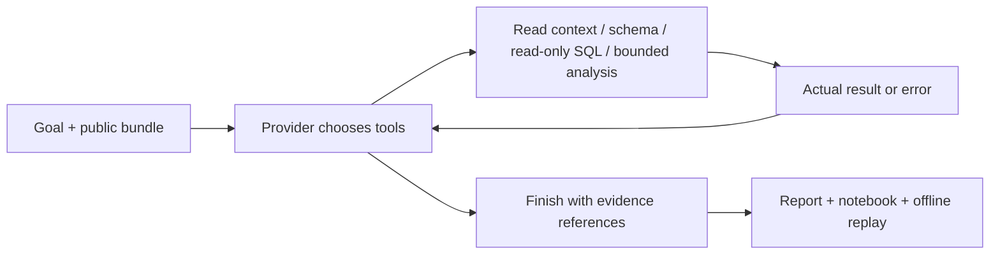

# Workflow Data Investigator

**Trace a metric change back to inspectable SQL, results and assumptions.**

The main product is a small Python toolkit for read-only investigation of local,
synthetic CSV data. It records each tool input, returned value and error, then
exports an HTML report, notebook and standalone offline replay.

中文：用合成数据演示“指标下降是否真的代表业务恶化”，保留每步查询、错误和证据，交付能复跑的结果。

**Public source:** [CamusFSY/workflow-data-investigator](https://github.com/CamusFSY/workflow-data-investigator).
The source was published on 2026-10-11; no package-index release has been made.
Commands below use a source checkout.

**Status: early-stage development.** The included demo driver is explicitly
**SCRIPTED MOCK**. It exercises real tools, but is not a model-autonomy benchmark.
A model can select actions through the Python provider interface; the CLI has no
live transport, API-key loader or automatic paid call. The included evidence and
checks do not establish general accuracy, model autonomy or external adoption.

## Try it locally

Use **Python 3.11+ on Linux**. Runtime and offline tests use only the standard
library. macOS and Windows are not part of the current CI matrix.

From a checkout of this repository:

```sh
python3 -m venv .venv
.venv/bin/python -m pip install ./data-investigation-agent
.venv/bin/data-investigator run \
  --fixture data-investigation-agent/fixtures/join_multiplier \
  --out runs/join-demo --inject-schema-error
.venv/bin/python runs/join-demo/replay.py
```

Open `runs/join-demo/report.html`. A deliberately invalid column produces a real
SQL error; the scripted driver observes it, inspects the schema and changes its
next query. The trace keeps the error and the later results. Every output path
must be new, so a repeated run should use a different `--out` value.

No installation is needed for the source checkout: from
`data-investigation-agent/`, run `python3 -m investigator` with the same arguments
and a fixture path relative to that directory.

## Three supported demonstrations

| Fixture | Question it illustrates | Expected behavior |
|---|---|---|
| `join_multiplier` | Did a join change the unit being counted? | Compare joined rows with distinct orders; the apparent decline disappears at order grain. |
| `delivery_slip` | Does a decline remain after correcting the metric? | Compute the decline and locate the affected group; no causal attribution is proved. |
| `missing_definition` | Is the time basis and eligible population specified? | Ask concrete questions and return `needs_clarification`. |

```sh
.venv/bin/data-investigator run \
  --fixture data-investigation-agent/fixtures/delivery_slip \
  --out runs/delay-demo
.venv/bin/data-investigator run \
  --fixture data-investigation-agent/fixtures/missing_definition \
  --out runs/clarification-demo
```

These fixtures are original synthetic examples. The scripted driver knows their
vocabulary; it is not a general analyst for arbitrary uploaded data. To reuse the
tools with a different synthetic schema, start with [bundle inspection](data-investigation-agent/docs/fixtures.md)
and supply a provider using the [integration contract](data-investigation-agent/docs/provider-integration.md).

## What you can inspect

| Output | Purpose |
|---|---|
| `report.html` / `report.json` | Findings with evidence references, unresolved questions and completion status |
| `trace.jsonl` | Ordered tool selections, inputs, actual returns and visible errors |
| `investigation.ipynb` | Fixed code cells replaying the actual recorded analysis |
| `replay.py` / `manifest.json` | Standalone replay and input/runtime integrity checks |



The demo uses `ScriptedMock` at the provider step. With a model provider, choices
come from the returned tool calls. The runtime does not select a diagnosis by
fixture name. Neither evidence references nor passing replay guarantee that free
text is correct; metric meaning, numerical validity and explanatory support are
separate questions. Generic rates retain neutral labels and source columns.

## Development and limitations

```sh
cd data-investigation-agent
python3 -B -m unittest discover -s tests -v
```

Tests cover real SQLite operations, read-only/resource limits, malformed batches,
error feedback, clarification state, notebook replay and artifact tampering.
[Contribution instructions](CONTRIBUTING.md) include a clean installed-wheel smoke.
[Hosted CI for the initial public commit](https://github.com/CamusFSY/workflow-data-investigator/actions/runs/38140217002)
passed on Python 3.11 and 3.12: 77 tests per version, wheel/source builds and
installed-wheel checks with all three offline replays. See the
[workflow](.github/workflows/ci.yml) and [publication evidence](docs/public-release.md)
for the checked commit and scope.

The SQL tools are bounded; the trusted Python host is **not** an arbitrary-code
sandbox. Inputs and returned rows are copied into evidence bundles. Use synthetic
data, review bundles before sharing, and read [SECURITY.md](SECURITY.md).

## Next contributions

The current focus is making the small toolkit easy to reproduce and maintain.
Useful contributions include minimal synthetic bug cases, clearer schema errors,
packaging portability and documentation tested by an actual new user. There is
no claim of established external adoption, independent human review or a novel
benchmark advantage.

- [Tool API and troubleshooting](data-investigation-agent/README.md)
- [Evaluation scope and replay](docs/evaluation.md)
- [Roadmap](docs/roadmap.md) · [Changelog](CHANGELOG.md)
- [Public source scope and verification](docs/public-release.md)

Code is licensed under [Apache-2.0](LICENSE). See
[third-party notices](THIRD_PARTY_NOTICES.md) for component provenance and input
scope. Source publication does not imply program approval, deployment or a
package-index release.
