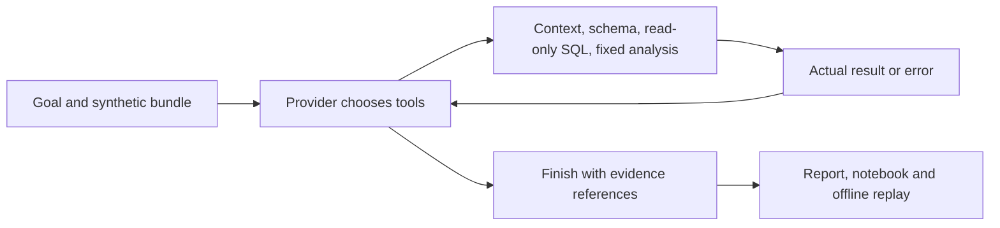
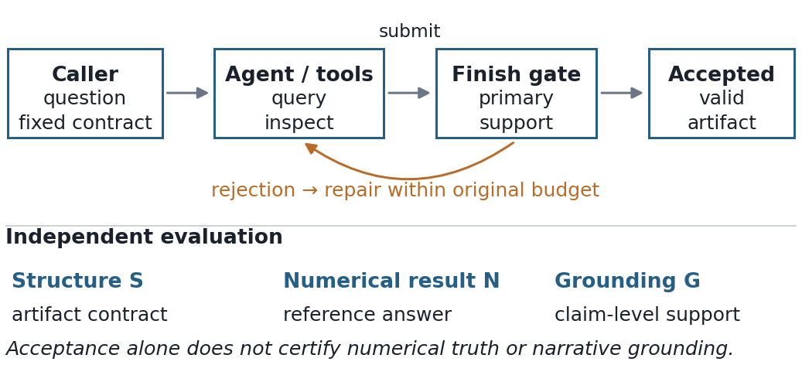

# Workflow Data Investigator

[](https://github.com/CamusFSY/workflow-data-investigator/actions/workflows/ci.yml?query=branch%3Amain)
[](LICENSE)
[](.github/workflows/ci.yml)
[](data-investigation-agent/pyproject.toml)

**Investigate a metric change with inspectable SQL, visible errors and replayable evidence.**

A small Python toolkit for exploring local synthetic CSV data. A provider chooses
bounded tools, observes their results, and returns an HTML report, notebook and
standalone replay. The runtime uses only Python's standard library.

Local preparation also supports an explicit [public-data snapshot contract](data-investigation-agent/docs/public-data.md).
Its registry starts empty. The [fixed WDI smoke recipe](data-investigation-agent/docs/wdi-smoke.md)
can explicitly admit one verified source snapshot. Admission pins source, license
and every input byte. A separate [frozen live evaluation](data-investigation-agent/docs/live-evaluation.md)
reports a small adapted BIRD comparison, including its failures and limits.
Read the [technical report draft](docs/research/technical-report/workflow-data-investigator-technical-report.pdf)
for the study design, observed costs and remaining limitations.

中文：用合成数据调查“指标下降是否真的代表业务恶化”，保留查询、错误、口径和可复跑证据。

[Quickstart](#quickstart) · [Captioned demo](docs/showcase-demo.md) · [Showcase source](site/index.html) · [Demo results](#demo-results) · [Live evaluation](data-investigation-agent/docs/live-evaluation.md) · [Research](#research) · [Documentation](docs/README.md) ·
[Contributing](CONTRIBUTING.md) · [Security](SECURITY.md)

**Alpha.** Included demos are labeled **SCRIPTED MOCK** or **OFFLINE RECORDED
RESPONSES**. They run real tools with fixed provider behavior; they do not prove
model autonomy. A caller-supplied model can use the Python interface; the linked
live evaluation covers one configuration, not general provider compatibility or
external adoption. The CI badge shows
`main`; it does not certify an unmerged branch. No package-index release is available.

## Quickstart

Use **Python 3.11+ on Linux**. CI tests Python 3.11 and 3.12; macOS and Windows
are not currently verified. No model account, API key or notebook server is needed.

```sh
git clone https://github.com/CamusFSY/workflow-data-investigator.git
cd workflow-data-investigator
python3 -m venv .venv
.venv/bin/python -m pip install ./data-investigation-agent
.venv/bin/data-investigator run \
  --fixture data-investigation-agent/fixtures/join_multiplier \
  --out runs/join-demo --inject-schema-error
.venv/bin/python runs/join-demo/replay.py
```

Open **`runs/join-demo/report.html`** in your browser. Expand a tool step to see
its actual input and return. The intentional bad-column query remains visible
alongside the schema check and corrected query. Each run requires a new `--out`
path so earlier evidence is preserved.

If you already have a checkout, start at the `python3 -m venv` line. An
[installation-free command](data-investigation-agent/README.md#quickstart) is
also available. Build tooling may be downloaded during installation; the runtime
and offline demonstrations make no model API calls.

## Demo results

These are **expected results from the included synthetic fixtures**, computed
with the current offline drivers. They are not model evaluations or production
measurements. [Reproduce and inspect the outputs](docs/demo-output.md).

| Example | Observed result | Outcome |
| --- | --- | --- |
| Join duplication | Joined rows: 90.0% → 69.2%; distinct orders: 90.0% → 90.0% | The apparent decline disappears at order grain; 14 actions with the injected error. |
| Delivery delay | Distinct orders: 90.0% → 60.0%; North: 90.0% → 30.0% | Decline remains; group localization is descriptive, not causal; 12 actions. |
| Missing definition | Time basis and cancelled-order policy are unresolved | Concrete questions and `needs_clarification`; 3 actions. |
| Custom simulation CSV | Passed/eligible runs: 5/6 → 3/6 | 9 recorded actions including SQL error, repair, analysis and chart. |

Every investigation exports:

| File | What to inspect |
| --- | --- |
| `report.html` / `report.json` | Cited findings, completion status and unresolved questions |
| `trace.jsonl` | Tool choices, inputs, actual results and errors in order |
| `investigation.ipynb` | Fixed code cells for the recorded queries and calculations |
| `replay.py` / `manifest.json` | Standalone replay with copied-input and runtime hashes |
| `response_diagnostics.jsonl` | Response structure and protocol rejection reasons |

A successful replay checks the recorded calculations. It does not approve a
business definition or verify every sentence in the provider's explanation.

With an optional [answer contract](data-investigation-agent/docs/evidence-roles.md),
callers can require one explicitly selected answer query and keep supporting
evidence separate. Reports and replay retain the caller's expected column types
and row bounds. These checks validate structure; numerical correctness remains
a separate assessment. A runnable offline CLI example is included in that guide.

## Use your own synthetic CSV

A bundle contains a catalog, metric definition, dashboard SQL, request and declared
CSV files. Validation checks types, paths and resource limits locally. Follow the
[complete bundle guide](data-investigation-agent/docs/fixtures.md) to replace the
example's schema and define the entity, denominator, time basis and exclusions.

From the repository root, with the virtual environment above:

```sh
example_dir=data-investigation-agent/examples
.venv/bin/data-investigator validate \
  --bundle "$example_dir/simulation_bundle"
.venv/bin/data-investigator investigate \
  --bundle "$example_dir/simulation_bundle" \
  --responses "$example_dir/simulation_responses.json" \
  --out runs/simulation-example
.venv/bin/python runs/simulation-example/replay.py
```

This example uses hand-authored response bodies and actual SQL/analysis. Changing
CSV counts changes the arithmetic; the fixed responses cannot diagnose an arbitrary
question. For model-selected actions, use the [callback or configured-client
integration](data-investigation-agent/docs/provider-integration.md). It requires
explicit data-sharing consent; the caller owns credentials, retries and costs.
The CLI does not discover keys or start a paid request.

## Method: from a tool loop to an answer artifact



The provider chooses actions from the current messages and tool schemas. The
runtime validates each batch, executes its tools in order and returns actual
results or errors with evidence IDs. A later provider turn can use that feedback.
SQL is read-only; analysis functions are fixed. Scripted and recorded providers
exercise this same protocol offline, but their choices are not new model decisions.

An optional **caller-frozen answer contract** makes the final artifact explicit:

1. **Freeze before the first request.** The caller supplies expected column names
   and order, types, nullability and row-count bounds. The runner validates and
   copies this contract. It contains no expected values or reference SQL, and a
   model-visible document or later model response cannot replace it.
2. **Select the answer.** For an `answered` or `conditional` finish,
   `answer_evidence_id` names one successful,
   untruncated query from the current run. `supporting_evidence_ids` separately
   names context, schema checks, queries, analysis or plots. The runtime does not
   choose the first, last or best-looking query on the provider's behalf.
   A `needs_clarification` finish can omit an answer if it retains a supporting
   source and a concrete unresolved question or assumption.
3. **Validate, then accept or return feedback.** Source, role and shape failures
   are tool observations. During ordinary turns, the provider may repair a
   rejected finish using the original remaining budget. Rejection creates no
   additional budget; a rejected terminal finish-only submission ends the run.
4. **Export the record.** Reports expose the chosen answer and its supports;
   traces preserve errors and rejected attempts. Replay restores the frozen
   contract, checks copied-input hashes and re-executes recorded tool operations.

For a one-row contract with only an integer `publisher_id`, returning the correct
ID plus `publisher_name` fails the interface. Returning a wrong integer alone
can pass it. A correct table can also have an incorrect summary. These examples
separate three questions:

| Check | What it establishes | What it does not establish |
| --- | --- | --- |
| Structural validation | The selected source, types and result shape meet the frozen contract | Numerical correctness or support relevance |
| Independent numerical verification | The selected result matches a task-specific reference | Truth of every narrative claim |
| Narrative grounding | Each reviewed claim follows from available evidence | Metric authority, causal identification or universal reliability |

The [research draft](docs/research/technical-report/workflow-data-investigator-technical-report.pdf)
formalizes three elementary interface properties with their assumptions:

- **Conditional structural soundness.** With a fixed contract, stable trusted
  records and a sound finish gate, acceptance implies that the selected primary
  is successful, complete and contract-conforming, with usable role references.
- **Shape cannot certify meaning.** A deterministic validator observing only
  structural features cannot distinguish structurally equivalent results whose
  numerical correctness differs. A correct table can still have a false summary.
- **Bounded continuation.** Finite original request and action caps bound repair
  attempts. They guarantee neither acceptance nor a correct answer.



Writing `V(answer, contract)` for the runtime's structural check, `V` does not
imply numerical correctness or grounded prose. Replay is another distinct check:
it verifies recorded computations and integrity **relative to the supplied
manifest**, not the authenticity of a replaced manifest. This is an engineering
boundary, not a new learning algorithm or formal verification of the software.

The runnable [offline role example](data-investigation-agent/docs/evidence-roles.md#recorded-cli-and-configured-client)
retains the `reporting_week` SQL error at `e004`, inspects schema at `e005`, and
selects the corrected `e006` query. It returns two period/count rows and keeps
`e002`, `e003`, `e007` and `e008` as support. Those actions are hand-authored;
the SQL, counts and replay are actual execution. Omit the contract to retain
the legacy multi-reference finish interface.

See the [architecture and trust boundaries](docs/architecture.md),
[provider contract](data-investigation-agent/docs/provider-integration.md) and
[answer-role rules](data-investigation-agent/docs/evidence-roles.md) for exact
interfaces, limits and failure behavior. The [captioned demo and capture instructions](docs/showcase-demo.md)
walk through a real offline run and its report.

Use synthetic inputs or an explicitly reviewed public snapshot. The host and caller's transport are trusted code,
not an arbitrary-code sandbox. Generic analysis remains an untyped ratio: it
cannot establish metric authority, causation or statistical significance.
[Evaluation scope](docs/evaluation.md) separates offline checks, observed live
behavior and remaining validation gaps.

## Research

The [technical report](docs/research/technical-report/workflow-data-investigator-technical-report.pdf), Evidence Roles and Answer Contracts in Data Analysis Agents, documents a small same-build validation on three fresh BIRD Mini-Dev question families. Explicit mode passed strict end-to-end checks in 3/3 families versus legacy mode in 2/3. Both modes answered the substantive questions correctly; the difference was one output-shape repair.

Explicit mode used 14 requests and CNY 0.102346, compared with 11 requests and CNY 0.079332 for legacy mode. Four exposed regressions passed numerical checks, but one still failed end-to-end because its summary miscounted a group in the correct ranking. The report separates structure, numerical verification, and narrative grounding. It does not establish arithmetic superiority, statistical significance, or an official BIRD score.

Status: 11-page research draft in NeurIPS 2026 preprint style, with [editable source](docs/research/technical-report/report.tex); not submitted, peer-reviewed or accepted at NeurIPS. An earlier, separate [64-episode clarification pilot](docs/research/research-overview.md) provides historical context and is not pooled with the product evaluation.

## Contribute and verify

```sh
cd data-investigation-agent
python3 -B -m unittest discover -s tests -v
```

[CONTRIBUTING.md](CONTRIBUTING.md) covers reproducible bug reports, the installed-wheel
smoke, tests and pull requests. Read [SECURITY.md](SECURITY.md) before sharing a trace
or reporting a vulnerability. Small synthetic bug cases and improvements observed
by real users are useful contributions.

[Documentation index](docs/README.md) · [Roadmap](docs/roadmap.md) ·
[Changelog](CHANGELOG.md) · [Source publication record](docs/public-release.md)

## License

Source code and original synthetic fixtures are licensed under **[Apache-2.0](LICENSE)**.
The [package license](data-investigation-agent/LICENSE) and
[package metadata](data-investigation-agent/pyproject.toml) carry the same license.
[Component notices](THIRD_PARTY_NOTICES.md) describe the shipped materials and build tools.
