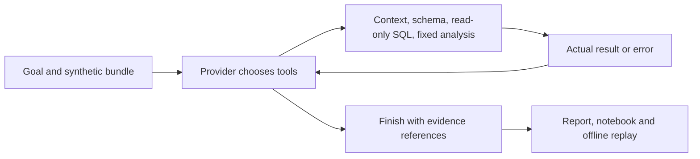

# Workflow Data Investigator

[](https://github.com/CamusFSY/workflow-data-investigator/actions/workflows/ci.yml?query=branch%3Amain)
[](LICENSE)
[](.github/workflows/ci.yml)
[](data-investigation-agent/pyproject.toml)

**Investigate a metric change with inspectable SQL, visible errors and replayable evidence.**

A small Python toolkit for exploring local synthetic CSV data. A provider chooses
bounded tools, observes their results, and returns an HTML report, notebook and
standalone replay. The runtime uses only Python's standard library.

中文：用合成数据调查“指标下降是否真的代表业务恶化”，保留查询、错误、口径和可复跑证据。

[Quickstart](#quickstart) · [Demo results](#demo-results) · [Documentation](docs/README.md) ·
[Contributing](CONTRIBUTING.md) · [Security](SECURITY.md)

**Alpha.** Included demos are labeled **SCRIPTED MOCK** or **OFFLINE RECORDED
RESPONSES**. They run real tools with fixed provider behavior; they do not prove
model autonomy. A caller-supplied model can use the Python interface, but no
end-to-end live integration or external adoption is claimed. The CI badge shows
`main`; it does not certify an unmerged branch. No package-index release is available.

## Quickstart

Use **Python 3.11+ on Linux**. CI tests Python 3.11 and 3.12; macOS and Windows
are not currently verified. No model account, API key or notebook server is needed.

```sh
git clone https://github.com/CamusFSY/workflow-data-investigator.git
cd workflow-data-investigator
python3 -m venv .venv
.venv/bin/python -m pip install ./data-investigation-agent
.venv/bin/data-investigator run \
  --fixture data-investigation-agent/fixtures/join_multiplier \
  --out runs/join-demo --inject-schema-error
.venv/bin/python runs/join-demo/replay.py
```

Open **`runs/join-demo/report.html`** in your browser. Expand a tool step to see
its actual input and return. The intentional bad-column query remains visible
alongside the schema check and corrected query. Each run requires a new `--out`
path so earlier evidence is preserved.

If you already have a checkout, start at the `python3 -m venv` line. An
[installation-free command](data-investigation-agent/README.md#quickstart) is
also available. Build tooling may be downloaded during installation; the runtime
and offline demonstrations make no model API calls.

## Demo results

These are **expected results from the included synthetic fixtures**, computed
with the current offline drivers. They are not model evaluations or production
measurements. [Reproduce and inspect the outputs](docs/demo-output.md).

| Example | Observed result | Outcome |
| --- | --- | --- |
| Join duplication | Joined rows: 90.0% → 69.2%; distinct orders: 90.0% → 90.0% | The apparent decline disappears at order grain; 14 actions with the injected error. |
| Delivery delay | Distinct orders: 90.0% → 60.0%; North: 90.0% → 30.0% | Decline remains; group localization is descriptive, not causal; 12 actions. |
| Missing definition | Time basis and cancelled-order policy are unresolved | Concrete questions and `needs_clarification`; 3 actions. |
| Custom simulation CSV | Passed/eligible runs: 5/6 → 3/6 | 9 recorded actions including SQL error, repair, analysis and chart. |

Every investigation exports:

| File | What to inspect |
| --- | --- |
| `report.html` / `report.json` | Cited findings, completion status and unresolved questions |
| `trace.jsonl` | Tool choices, inputs, actual results and errors in order |
| `investigation.ipynb` | Fixed code cells for the recorded queries and calculations |
| `replay.py` / `manifest.json` | Standalone replay with copied-input and runtime hashes |
| `response_diagnostics.jsonl` | Response structure and protocol rejection reasons |

A successful replay checks the recorded calculations. It does not approve a
business definition or verify every sentence in the provider's explanation.

## Use your own synthetic CSV

A bundle contains a catalog, metric definition, dashboard SQL, request and declared
CSV files. Validation checks types, paths and resource limits locally. Follow the
[complete bundle guide](data-investigation-agent/docs/fixtures.md) to replace the
example's schema and define the entity, denominator, time basis and exclusions.

From the repository root, with the virtual environment above:

```sh
example_dir=data-investigation-agent/examples
.venv/bin/data-investigator validate \
  --bundle "$example_dir/simulation_bundle"
.venv/bin/data-investigator investigate \
  --bundle "$example_dir/simulation_bundle" \
  --responses "$example_dir/simulation_responses.json" \
  --out runs/simulation-example
.venv/bin/python runs/simulation-example/replay.py
```

This example uses hand-authored response bodies and actual SQL/analysis. Changing
CSV counts changes the arithmetic; the fixed responses cannot diagnose an arbitrary
question. For model-selected actions, use the [callback or configured-client
integration](data-investigation-agent/docs/provider-integration.md). It requires
explicit data-sharing consent; the caller owns credentials, retries and costs.
The CLI does not discover keys or start a paid request.

## How it works



The runtime validates tool calls, executes them within bounds and returns evidence
to the provider. Model providers make their next choice from those returns;
scripted and recorded providers exercise the same protocol offline. See the
[architecture and trust boundaries](docs/architecture.md) for component links,
limits and failure behavior.

Use synthetic inputs only. The host and caller's transport are trusted code,
not an arbitrary-code sandbox. Generic analysis remains an untyped ratio: it
cannot establish metric authority, causation or statistical significance.
[Evaluation scope](docs/evaluation.md) separates what the checks prove from
what still needs live validation.

## Contribute and verify

```sh
cd data-investigation-agent
python3 -B -m unittest discover -s tests -v
```

[CONTRIBUTING.md](CONTRIBUTING.md) covers reproducible bug reports, the installed-wheel
smoke, tests and pull requests. Read [SECURITY.md](SECURITY.md) before sharing a trace
or reporting a vulnerability. Small synthetic bug cases and improvements observed
by real users are useful contributions.

[Documentation index](docs/README.md) · [Roadmap](docs/roadmap.md) ·
[Changelog](CHANGELOG.md) · [Source publication record](docs/public-release.md)

## License

Source code and original synthetic fixtures are licensed under **[Apache-2.0](LICENSE)**.
The [package license](data-investigation-agent/LICENSE) and
[package metadata](data-investigation-agent/pyproject.toml) carry the same license.
[Component notices](THIRD_PARTY_NOTICES.md) describe the shipped materials and build tools.
