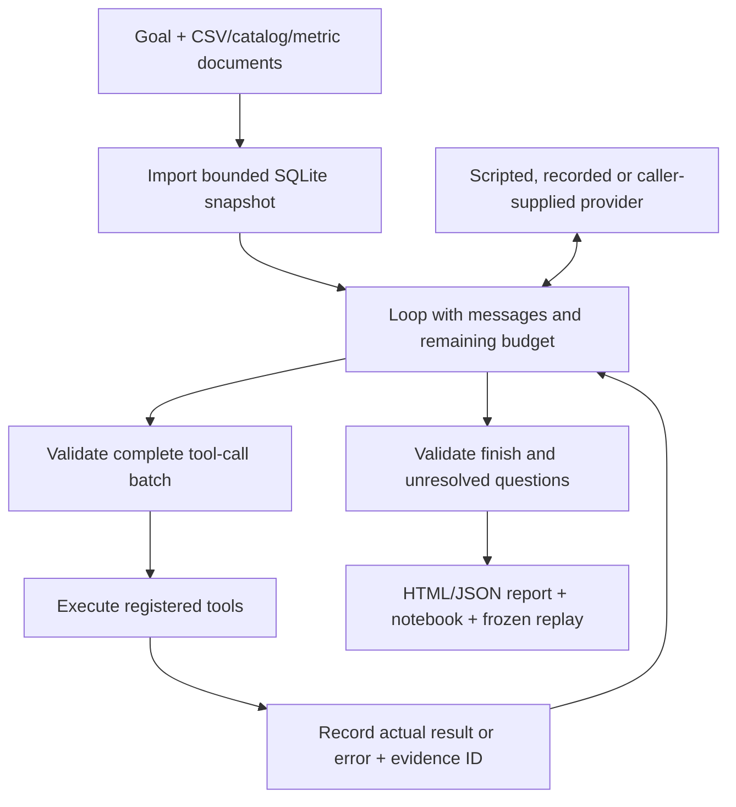

# Architecture and boundaries

A run starts with a goal, a declared synthetic bundle, a fresh output directory
and a provider. The [provider contract](../data-investigation-agent/docs/provider-integration.md)
is checked before reading input or creating output. No fixture name selects a
business diagnosis in the runtime.

## Components

| Component | Responsibility |
| --- | --- |
| [Bundle importer](../data-investigation-agent/investigator/bundle.py) | Validate declared files and copy them into a bounded local snapshot |
| [Provider loop](../data-investigation-agent/investigator/loop.py) | Offer tools, preserve feedback IDs, reserve a finish opportunity and record failures |
| [Provider adapters](../data-investigation-agent/investigator/providers.py) | Adapt an explicitly authorized callback; no SDK, key discovery or billing ledger |
| [Tool runtime](../data-investigation-agent/investigator/runtime.py) | Context/schema reads, queries, fixed arithmetic, charts and evidence-bound finish |
| [SQL worker](../data-investigation-agent/investigator/sql_worker.py) | Execute allowed read-only SQLite operations in a short-lived process |
| [Artifact exporter](../data-investigation-agent/investigator/artifacts.py) | Escape report text and export actual events, templates and integrity hashes |
| [Replay verifier](../data-investigation-agent/investigator/replay.py) | Recompute saved actions and compare results, including recorded errors |

`ScriptedMock` knows the delivery demonstration vocabulary. `RecordedProvider`
returns fixed response bodies in order. Neither makes new model decisions. A
model transport receives the latest messages and tool schema, and its returned
tool calls determine subsequent actions. Only a later provider turn can react
to results from a previous batch.

## Limits and failure behavior

The default run allows 24 provider turns, 24 total tool actions and a 60-second
provider/tool loop. Configurable maxima are 40 turns, 40 actions and 120 seconds;
input preparation and artifact export are outside that deadline. Each response
contains at most four calls; `finish` must be alone. Context is capped at 250,000 bytes.

The SQL connection is read-only, extensions are disabled, and an authorizer
restricts statements and functions. The worker has a 3-second parent timeout,
256 MiB address-space limit and 2-second CPU limit. Results return at most 200
rows and 64 KiB, with an explicit truncation flag. The
[bundle guide](../data-investigation-agent/docs/fixtures.md) lists import bounds.

Tool errors enter the trace and provider feedback. A later provider or protocol
failure exports a failed report with the evidence already collected. Missing
metric-authority questions remain unresolved until a trusted caller supplies an
answer and source; deleting a question cannot approve a business definition.
`needs_clarification` and `conditional` are not completed unconditional answers.

## Trust and interpretation

No tool executes model-authored Python, a shell or arbitrary file paths.
Notebooks contain fixed replay templates. The host Python process, caller's
provider and clarification resolver remain trusted code; process limits do not
make them a hostile-code sandbox.

Offline modes make no model call. With explicit sharing consent, a model
transport may receive context, schema, SQL, returned rows and conversation.
The caller owns endpoint policy, credentials, retries, timeouts and costs.
Attempts and returned token metadata do not prove a charge or a spending cap.

Evidence IDs bind claims to recorded events, not to validated metric meaning.
Read-only SQL, correct arithmetic and replay do not establish authority,
causation, statistical significance or free-text truth. See
[security](../SECURITY.md) and [evaluation scope](evaluation.md).
